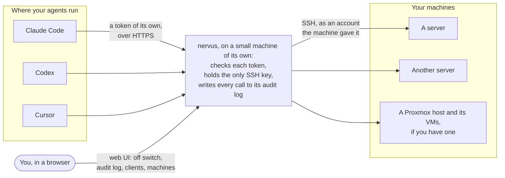
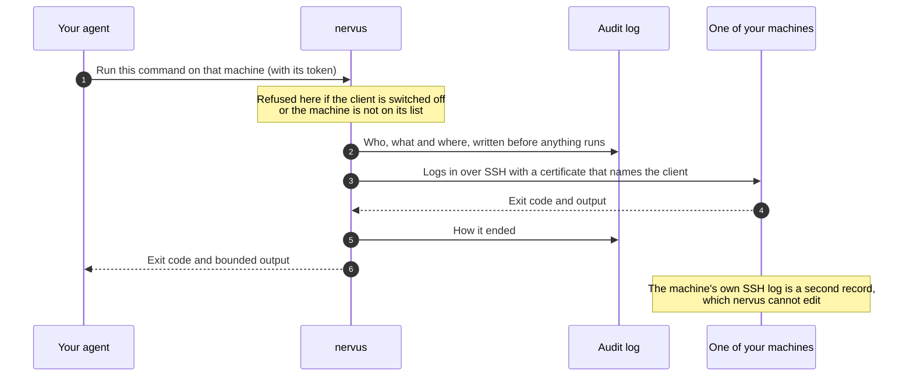
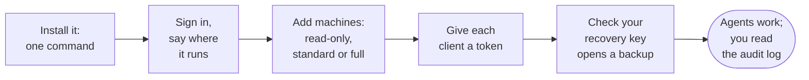

# nervus — an early preview

nervus gives AI agents (Claude Code, Codex, Cursor) a way to do real work on your own machines
over SSH, without handing any of them an SSH key. It runs as one small service on a machine of
its own and holds the only key. Each client gets its own token, with a list of the machines it may
reach, and every call is written to an audit log before it runs and after: who ran what, where, and
how it ended.

**This is an early preview, public so that anyone can try it and say how they get on with it.** It
runs every day on its author's own machines. Expect rough edges, and please say where you hit them
(below).

## What it does

| tool | |
|---|---|
| `hosts` | the machines this client may reach |
| `exec` | run a command; bounded output, the full output kept on the machine |
| `exec_bg` | start a job that survives the client disconnecting and nervus restarting |
| `job` | a job's status and logs, or stop it |
| `put` / `get` | move a file between nervus and a machine |
| `export` | save a file from a machine or a VM onto the client's own computer, checked by SHA-256 |
| `proxmox` | the Proxmox API, if you have a Proxmox host: make, use and destroy VMs |

**Nothing is installed on the machines nervus reaches.** It logs in over SSH as an account it was
given. That is a choice, argued in ADR-0005: every connection also lands in the machine's own SSH
log, a second record nervus cannot edit.

**The boundary is the machine's, not a filter in nervus.** nervus does not inspect commands
(ADR-0001 s5); what a client can do is what the account it reaches can do. A web UI lets you
switch any client off at once, or all of them, and read the audit log (ADR-0003, ADR-0013,
ADR-0014).

## How it works

**Where everything sits.** Your agents never hold an SSH key. Each has a token of its own; nervus holds
the one key, checks what each token may reach, and writes every call down.

**One call, start to finish.**

## What works, and what does not yet

**Works:** everything in the table, a backup of nervus once a day that only you can open, restored with
one command (ADR-0027; shown by tests and on throwaway machines), the web UI with sign-in and first-run setup (ADR-0015), the off
switch, client tokens issued from the UI, downloads and uploads (ADR-0016, ADR-0020), VMs made from a template on Proxmox and
used by their id, enrolled by nervus on the first call (ADR-0022), machines added from the web UI
by an admin login given once, or with two lines run on them, at the level their owner chooses:
read-only, standard or full (ADR-0024, ADR-0026), HTTPS that Claude Code and Codex trust: each client machine saves nervus's root
once, with `tools/nervus-trust`, after comparing one fingerprint (ADR-0021), and upgrading to a newer release with one command, which
keeps everything of yours and goes back by itself if the new release does not come up (ADR-0029; shown by tests and on throwaway
machines).

**Not yet:**
- **No container image.** One script installs it on its machine; the rest happens in its web UI:
  `docs/install.md`.
- **Cursor is not yet tested** over HTTPS with nervus's root, and the connector that would remove
  even the one-file step for every client is later work (ADR-0008).
- **The machines nervus reaches must be Linux.** A Mac is not covered yet. Read-only is tried on
  Debian 13, Ubuntu 24.04 and Ubuntu 26.04, not yet on Ubuntu's other releases.

## What nervus does not defend against

nervus gives you containment and accountability, not prevention: each client reaches only the
machines its token names, at the level each machine allows; you can switch any client off at once;
and every call is in the audit log. It does not defend against:

- **Programs running as you on a computer where a client runs:** they can read the token that client
  uses.
- **Whoever runs this nervus:** anyone with root on its machine can read its key and tokens,
  rewrite its audit log, and see a password you type to add a machine.
- **A client with full access to the machine underneath nervus:** if nervus runs there as a VM or
  container, that client can stop nervus and rewrite its audit log. nervus refuses full access to
  its own machine, but cannot tell which machine hosts it, so the Machines page asks you.
- **Someone at an unlocked computer where a client runs, or where you are signed in to nervus's web
  UI.**
- **What you ask for:** an agent with full access to a machine can do anything you could there,
  destroying it included. nervus records it; it does not prevent it.
- **A machine attacking its own data.**
- **Losing the recovery key, or giving it away.** nervus's backups hold its keys, locked to a
  recovery key only you hold: whoever has that key and a backup can open every secret nervus has, and
  without it no backup can be opened, nervus's own included.
- **A compromised nervus, by restoring it.** A backup brings back the same keys, and so whatever an
  attacker took with them; recovering from that is new keys, and every machine and client enrolled
  again.
- **Separate people.** One nervus is one trust domain: there are no user accounts, so everyone who
  can sign in to its web UI reads every client's audit log, issues and revokes every token, and adds
  every machine. People sharing a nervus share all of it; give each person their own.

**What keeps the record of which client did what.** nervus writes each call to its audit log
before anything reaches a machine, so a command cannot remove the record of itself, an attempt to
tamper with logs included. No client can read or write that log, and no client is given root on
nervus's own machine. This holds with nothing set up anywhere else. A copy of the log elsewhere
guards against whoever runs nervus, not against clients; and a copy on a machine a client has full
access to is not a copy. Each machine's own log also names the client behind every login, written by
the machine itself, but a client with full access there can edit it afterwards.

**Reaching nervus from the internet is not supported.** Never forward a port on your router to
nervus; to reach it from outside, use an overlay network such as Tailscale or WireGuard. nervus warns
on every page of its web UI when it listens on an address that looks public, but it cannot see a
forwarded port.

nervus's setup page says the same, before you choose where it runs (its tier: `docs/install.md`,
"Where nervus may run").

## What an agent can do to you

The ordinary case, not the worst one: your agent reads something someone else wrote (an issue, a
pull request, a web page, a package's README) and that text tells it to run a command through
nervus. Agents follow such text more often than anyone would like. nervus does not filter commands,
since a filter is easy to talk around (ADR-0001 s5, ADR-0007 decision 1). What bounds the damage is
where the agent's token reaches, and at what level each machine was added:

- On a **read-only** machine it can read whatever nervus's account there can read, and run
  programs, but the machine's own kernel refuses any change outside nervus's folder `~/.nervus`,
  whatever nervus is told. Read-only stops changes, not reading: what that account can read, the
  agent can send anywhere the machine can reach.
- On a **standard** machine it can change what nervus's account owns there, and nothing that needs
  root.
- On a **full** machine it can do anything you could as root, wiping the machine included.
- Machines its token does not name are out of its reach.

When it happens, switch that client off in the web UI at once; the audit log shows what it ran,
where and when, and each machine's own SSH log holds a second record nervus cannot edit. So give each
client the fewest machines at the lowest level its work needs: read-only unless it must change
something.

## Getting started

1. Install it: **`docs/install.md`**. If you hand it to your own AI agent, it is written to be
   followed step by step, with a check after each.
2. Connect your clients: **`docs/clients.md`**.
3. To use nervus from Claude Code while working in this repository, copy `.mcp.json.example` to
   `.mcp.json` and put nervus's name in it. It reads the token from the environment variable
   `NERVUS_CLAUDE_CODE`, and Claude Code trusts nervus once `NODE_EXTRA_CA_CERTS` names its root
   (`docs/clients.md`, "Trust nervus's certificate").
   `docs/clients.md` shows the other way: the token kept in macOS's keychain and fetched by
   `tools/nervus-headers` when Claude Code connects.

## Reading this repository

| | |
|---|---|
| `decisions/` | Why nervus is the way it is: one record per decision, with the options that were not chosen. Start at ADR-0001. |
| `docs/` | How to install it and connect clients. |
| `src/nervus/` | The service. |
| `tests/` | Tests against real SSH, real tmux, real SFTP and a real MCP client. |
| `deploy/` | The systemd unit. |
| `tools/` | Scripts that set things up or check them; each says at its top what it does and who runs it. |
| `research/` | Research notes: prior art, and a plan for gathering feedback from the agents that use nervus. Not decisions. |

**A few things refer to what is not here.** The decision records cite "procedure NNN" and
"deployment note NNNN": records of how the author's own installation was built, kept private
because they describe the author's machines. ADR-0002 and ADR-0004 are stubs for the same reason.
Commit ids in the records point to that private history too, and will not resolve here. What a
record decided is always in the record itself.

**`AGENTS.md` and `CLAUDE.md` are the rules the author's agents follow when working on nervus.**
An agent you run inside this repository will load them and follow them too: one step at a time,
reading a machine before acting on it, and stopping to ask when a design question comes up.

## Feedback

Open an issue in this repository: what you tried, what you expected, and what happened. Rough
edges, confusing steps and "I gave up here" are all exactly what this preview is for.

**A security problem is the exception.** Report it privately, from this repository's Security tab
("Report a vulnerability"), so that it reaches the author before it reaches everyone.

## License

nervus is released under the Apache License, Version 2.0: see `LICENSE`. `NOTICE` carries the
copyright line, which stays with every copy passed on.
